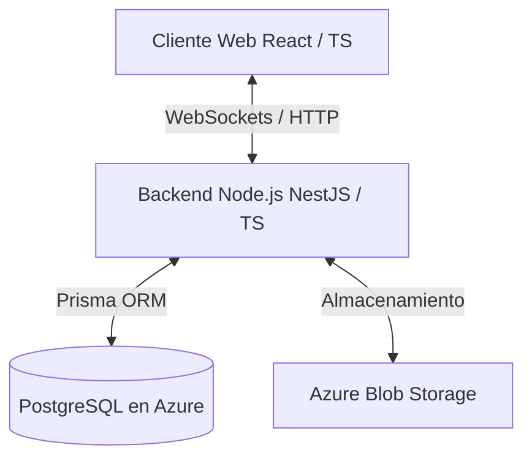

# Borrador de Arquitectura y Stack Tecnológico (To-Be)

Este documento detalla el stack de desarrollo propuesto y las decisiones de arquitectura de software para el **Sistema de Gestión de Actuaciones**. Esta base técnica está alineada con las exigencias de rendimiento, seguridad de nivel *Enterprise* y escalabilidad para la Defensoría del Pueblo de Jujuy.

---

## 1. Stack Tecnológico Principal

A partir de la propuesta base y las necesidades del sistema, se estructurará la siguiente arquitectura web:

### A. Frontend (Interfaz de Usuario)
*   **Biblioteca Principal:** **React (con TypeScript)**.
    *   *Razón:* TypeScript garantiza tipado estático, reduciendo drásticamente errores en tiempo de ejecución en sistemas complejos.
*   **Diseño y Estética Premium (WOW):** **TailwindCSS** + **shadcn/ui** (basado en Radix UI y Lucide Icons).
    *   *Razón:* Permite construir interfaces modernas, sumamente veloces, responsivas, accesibles y estéticamente impecables sin sobrecargar la carga del cliente.
*   **Gestión de Estado y Servidor:** **TanStack Query (React Query)** y **Zustand**.
    *   *Razón:* Ideal para cachear respuestas del servidor, manejar la cola de espera de forma ultra-eficiente y mantener el cliente liviano.

### B. Backend (Servicio API)
*   **Entorno:** **Node.js (con TypeScript)**.
*   **Framework de Servidor:** **NestJS** (Recomendado).
    *   *Sugerencia/Razón:* Para un sistema Enterprise, NestJS provee una arquitectura modular fuera de la caja, inyección de dependencias, fuerte soporte a TypeScript y excelente separación de conceptos. (Alternativa: *Express.js* si se prefiere una estructura minimalista).
*   **Comunicación en Tiempo Real:** **Socket.io (WebSockets)**.
    *   *Razón:* Indispensable para resolver el cuello de botella de la derivación de pases en tiempo real. Mesa de Entradas y Asesores recibirán eventos asíncronos instantáneos sin bloquear pantallas.

### C. Capa de Datos y Base de Datos
*   **Motor de Base de Datos:** **PostgreSQL**.
    *   *Razón:* Excelente soporte para relaciones Muchos a Muchos (N:M), consultas geográficas y transaccionalidad robusta (ACID) ideal para expedientes.
*   **ORM / Mapeador:** **Prisma**.
    *   *Razón:* Autocompletado robusto de consultas, migraciones seguras y tipado estricto que se integra perfectamente con TypeScript y PostgreSQL.

---

## 2. Entornos de Desarrollo e Infraestructura (DevOps)

Alineado con el perfil DevOps de desarrollo continuo:

*   **Entorno Local:** **Docker Desktop**.
    *   Toda la suite (Base de datos PostgreSQL local, Redis para WebSocket rooms y el servicio API) correrá dockerizada, garantizando que el entorno local replique exactamente el entorno de producción.
*   **Alojamiento en la Nube:** **Servicios de Microsoft Azure**.
    *   *Servicio Web:* **Azure App Service** (o *Azure Container Apps* para despliegues ligeros con Docker).
    *   *Base de Datos:* **Azure Database for PostgreSQL (Flexible Server)**, garantizando respaldos automáticos, alta disponibilidad y escalabilidad.
    *   *Digitalización / Archivos:* **Azure Blob Storage** para almacenar de forma segura y económica todos los archivos PDFs y escaneos adjuntos.

---

## 3. Sugerencias Técnicas Adicionales

1.  **Monitoreo y Diagnóstico:** Incorporar herramientas ligeras como **Sentry** (para trazar errores en el frontend y backend en tiempo real) y **Azure Monitor** para vigilar el rendimiento del servidor en la nube.
2.  **Validación de Datos:** Uso de **Zod** tanto en frontend como backend para asegurar que ningún dato inválido o inyectado ingrese al sistema (validación estricta de formularios y APIs).
