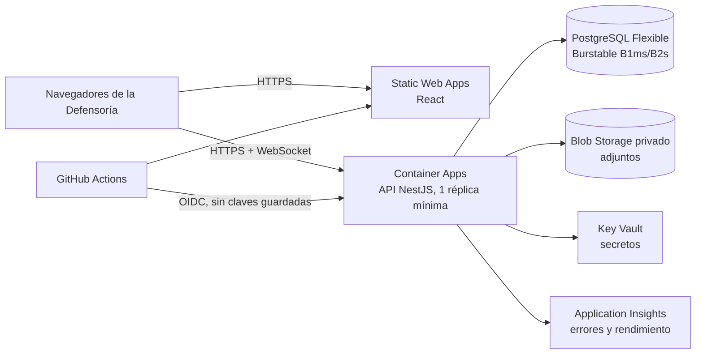

# DevOps — propuesta v0.1 (2026-11-19)

> Cómo se desarrolla, se prueba y se publica el sistema. Base: D-001 (React + NestJS + PostgreSQL/Prisma) y D-002
> (Azure). **Es una propuesta:** lo marcado ⏳ espera una respuesta de la Defensoría (`PREGUNTAS.md` P10–P12) y nada
> de Azure se crea sin confirmación explícita (REGLAS §4.9).

## 1. Estructura del repositorio (monorepo)
Monorepo = un solo repositorio con varias apps que comparten código.

```
gedefensoria/
├─ apps/
│  ├─ api/        NestJS + Prisma + Socket.io
│  └─ web/        React + Vite + Tailwind + shadcn/ui
├─ packages/
│  └─ shared/     esquemas Zod, tipos, estados del trámite (los usan front y back)
├─ docker/        compose local
├─ docs/
└─ .github/workflows/
```
- Gestor de paquetes: **pnpm** con workspaces (instala una sola vez las dependencias repetidas: ahorra disco y RAM).
- Versión de Node fijada en `.nvmrc` / `package.json#engines` (Node 22 LTS).

## 2. Entorno local (PC con poca memoria)
- **Docker solo para los servicios**, las apps corren directo en la PC (`pnpm dev`): consume bastante menos RAM que
  meter todo en contenedores.
- `docker/compose.yml` con límites de memoria:

| Servicio | Imagen | Para qué | RAM máx. |
|---|---|---|---|
| `db` | `postgres:16-alpine` | Base local (con `pg_trgm` y `unaccent`) | 512 MB |
| `azurite` | `mcr.microsoft.com/azure-storage/azurite` | Imita Azure Blob para adjuntos | 128 MB |
| `mailpit` | `axllent/mailpit` | Atrapa los e-mails de despacho (no sale nada a internet) | 64 MB |
| `redis` | `redis:7-alpine` | Solo con perfil `--profile redis`, si se prueban varias instancias | 64 MB |

- Comandos previstos: `pnpm servicios:up` / `pnpm servicios:down` (se apagan al terminar cada tanda),
  `pnpm db:migrate`, `pnpm db:seed` (catálogos + datos **inventados**), `pnpm dev`.
- Variables en `.env` (no se commitea) a partir de `.env.example` (sí se commitea, sin secretos).

## 3. Calidad antes de cada commit y en CI
- **Pre-commit** (`.githooks/pre-commit`): lint + tipos + tests rápidos de lo modificado. Se activa al crear el
  `package.json` (REGLAS §4.10).
- **GitHub Actions** (`.github/workflows/ci.yml`) en cada push y pull request:
  1. `pnpm install --frozen-lockfile`
  2. lint (ESLint) y formato (Prettier)
  3. tipos (`tsc --noEmit`) en las tres carpetas
  4. tests unitarios (Vitest / Jest) + tests de integración de la API contra un PostgreSQL de servicio del propio CI
  5. `prisma migrate diff` para detectar cambios de esquema sin migración
  6. build de `api` y `web`
  7. `pnpm audit` (dependencias con vulnerabilidades conocidas)
- Tests end-to-end (Playwright) de los flujos críticos — pase ME→Asesor, Borrador→Definitivo, reiteración — cuando
  existan esas pantallas.

## 4. Entornos
| Entorno | Dónde | Datos | Se publica |
|---|---|---|---|
| Local | PC del desarrollador | Inventados (seeder) | — |
| Pruebas (staging) | Azure, recursos chicos | Inventados | Automático al pasar CI en `main` |
| Producción | Azure | **Reales** | Manual, con aprobación (environment protegido de GitHub) |

Nunca se copian datos de producción a pruebas ni a local.

## 5. Azure (propuesta)



- **Front:** Azure Static Web Apps (sirve el React compilado; plan gratuito o estándar).
- **API:** Azure Container Apps con **mínimo 1 réplica siempre encendida** (sin "arranque en frío" y con los
  WebSockets estables). Con 1 réplica no hace falta Redis; si se escala a 2+, se suma Azure Cache for Redis para el
  adaptador de Socket.io. *Alternativa:* App Service Linux B1/B2 con contenedor — igual de válida; Container Apps
  queda mejor si después se agregan tareas programadas (vencimientos, respaldos de verificación).
- **Base:** PostgreSQL Flexible Server, nivel Burstable para empezar; respaldos automáticos con retención de 35 días;
  acceso solo por red privada o lista de IPs; TLS obligatorio.
- **Adjuntos:** Blob Storage privado, sin acceso público; la API entrega enlaces temporales (SAS de pocos minutos).
  Borrado lógico + retención (soft delete de Blob) para no perder digitalizaciones.
- **Secretos:** Key Vault + identidad administrada de la API (la app no guarda contraseñas de Azure). GitHub despliega
  con **OIDC** (federación: GitHub demuestra quién es sin una clave guardada).
- **Región** ⏳ P10: la más cercana es *Brazil South*. Ojo legal: la Ley 25.326 (art. 12) restringe transferir datos
  personales a países sin protección "adecuada"; hay que confirmar con Legal y Técnica si alojar fuera de Argentina
  está permitido o si hace falta otro esquema (servidor provincial, cláusulas contractuales).
- **Suscripción** ⏳ P11: quién la paga y administra (la Defensoría, la provincia o un proveedor).
- **Ingreso de usuarios** ⏳ P12: usuario y contraseña propios del sistema (con 2FA opcional) o login institucional
  (Microsoft Entra ID / Google Workspace del organismo, si existe).
- **Dominio** ⏳ P11: subdominio oficial (ej. `gestion.<dominio-de-la-defensoria>`) — lo gestiona TI de la provincia.

### Costo orientativo mensual (a validar con la calculadora de Azure antes de decidir)
Static Web Apps gratis/estándar · Container Apps 1 réplica chica · PostgreSQL B1ms con 32 GB · Blob con pocos GB ·
Application Insights con muestreo. El grueso es la base y la réplica siempre encendida. **No se da un número** hasta
tener la región (P10) y el plan de la suscripción (P11).

## 6. Publicación y migraciones
1. Push a `main` → CI verde → imagen de la API a GitHub Container Registry (o Azure Container Registry) → despliegue a
   **pruebas** → `prisma migrate deploy` → prueba de humo (endpoint `/salud`).
2. Producción: botón manual en GitHub (environment `produccion` con aprobación) → misma imagen ya probada → migraciones
   → humo. Si falla, se vuelve a la revisión anterior de Container Apps (un clic).
3. Migraciones solo "hacia adelante" y compatibles con la versión anterior (agregar antes que renombrar o borrar).

## 7. Respaldo, monitoreo y seguridad operativa
- **Respaldos:** automáticos de PostgreSQL + una **prueba de restauración trimestral** en pruebas, anotada en la bitácora.
- **Monitoreo:** Application Insights (errores, lentitud, caídas) con alertas por e-mail al responsable ⏳.
  Sentry queda como alternativa si se prefiere (ARQUITECTURA §3).
- **Registros (logs):** sin datos personales (se registran IDs, no nombres ni DNI).
- **Accesos a producción:** cuentas nominales, sin cuentas compartidas; nadie consulta la base de producción "a mano"
  salvo incidente, y queda registrado.
- **Dependencias:** Dependabot semanal en GitHub.

## 8. Orden de implementación (Fase 2)
1. Monorepo + `compose.yml` + `.env.example` → 2. Pre-commit activo → 3. CI → 4. Seeder con datos inventados →
5. (Con P10–P12 respondidas y confirmación) recursos de Azure de pruebas → 6. Despliegue continuo a pruebas →
7. Producción, recién cuando haya un circuito completo probado por la Defensoría.
