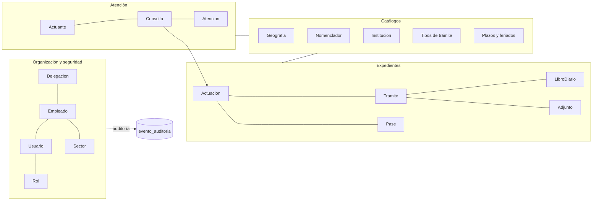
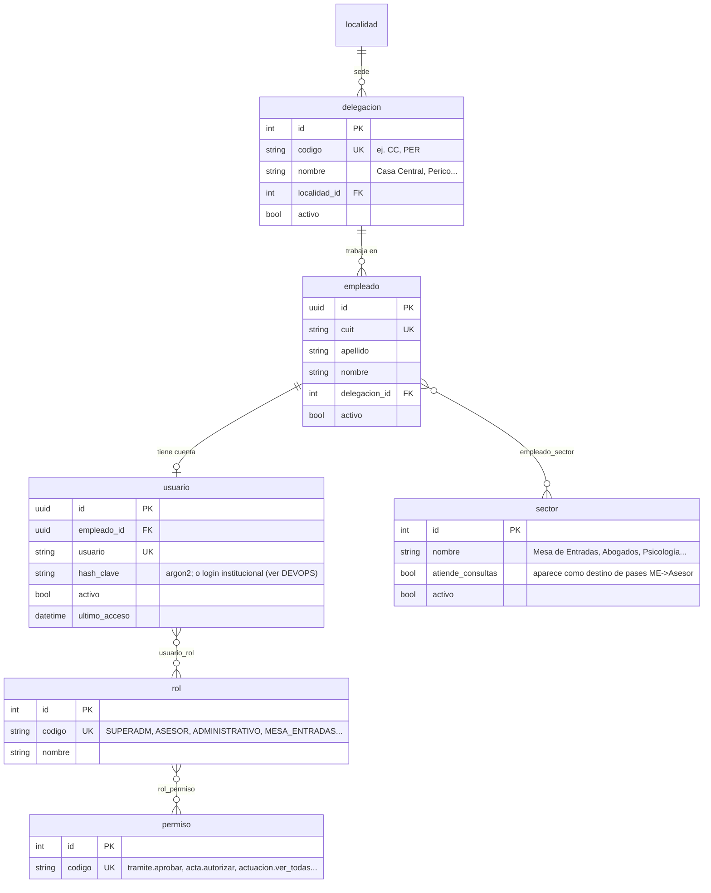
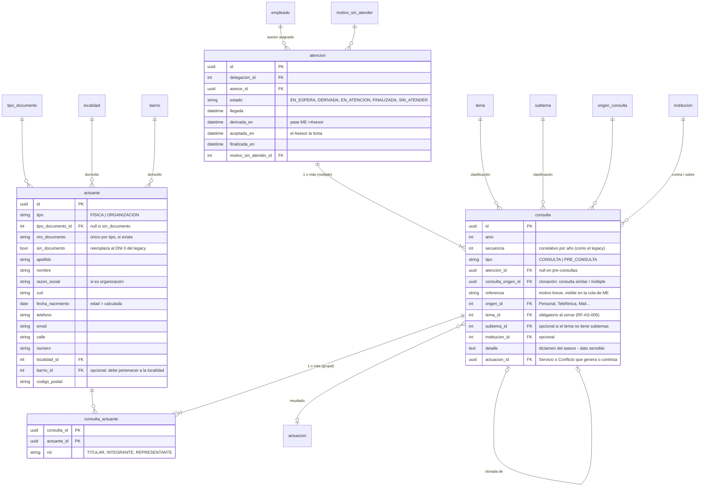
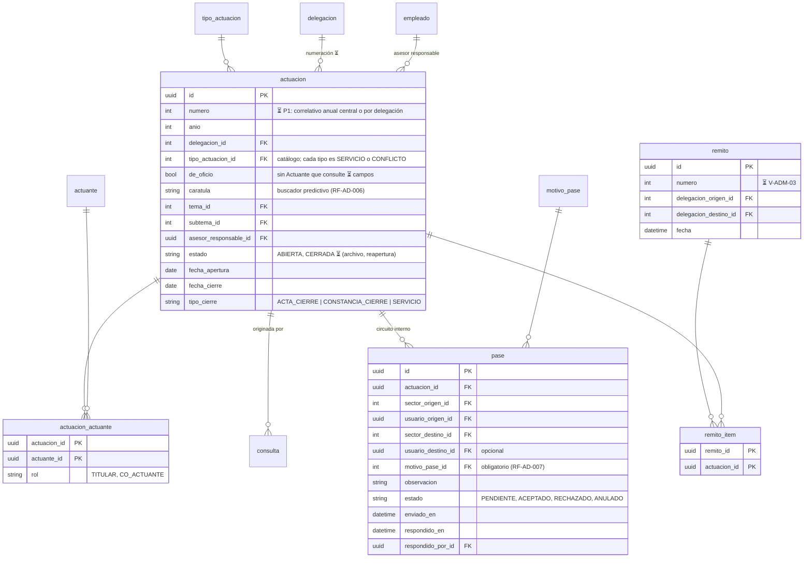
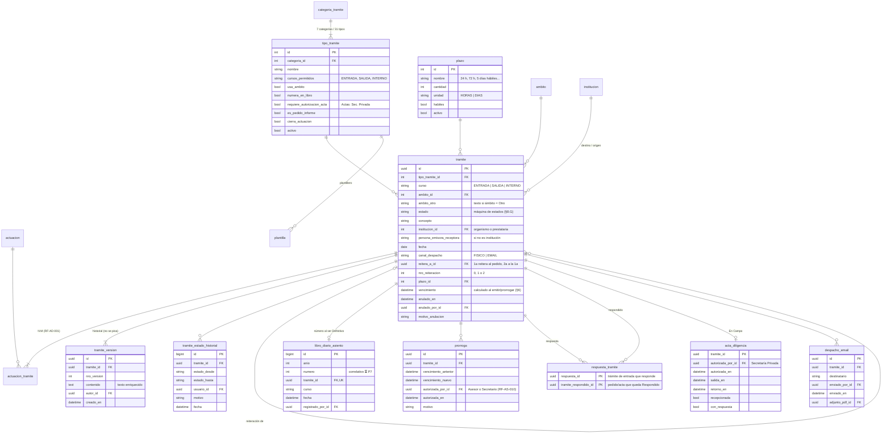
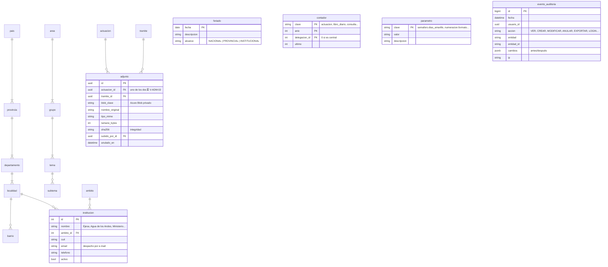

# Modelo de datos — borrador v0.1 (2026-11-19)

> Borrador del diagrama entidad-relación (ER: qué tablas hay y cómo se conectan) para PostgreSQL + Prisma (D-001).
> Sale de `RELEVAMIENTO.md` (§2–§8), `REQUERIMIENTOS.md` y la skill `gestion-expedientes`.
> **Marcas:** ⏳ = depende de una vista sin auditar o de una pregunta abierta (`PREGUNTAS.md`). Lo que no tiene marca
> se considera firme salvo que la Defensoría diga otra cosa.
> No es todavía el `schema.prisma`: se traduce a Prisma al arrancar la Fase 2.

## 1. Convenciones (D-004)
- **Nombres en español** y con la terminología del dominio: `actuante`, `actuacion`, `tramite`. Tablas en
  `snake_case`, modelos Prisma en `PascalCase`.
- **Identificadores:** UUID (v7, ordenable por fecha) en las entidades operativas (actuante, consulta, actuación,
  trámite, adjunto) para no exponer números correlativos en las URLs; `int` autoincremental en catálogos.
  El **número oficial** (ej. `123/2026`) es otro campo, nunca la clave.
- **Columnas comunes:** `creado_en`, `creado_por_id`, `actualizado_en`, `actualizado_por_id`.
- **Nunca borrar:** catálogos se desactivan (`activo = false`); trámites, adjuntos y pases se **anulan**
  (`anulado_en`, `anulado_por_id`, `motivo_anulacion`). La base de producción no da permiso de `DELETE` al usuario de
  la app sobre tablas operativas.
- **Lo derivado se calcula:** edad (de la fecha de nacimiento), tiempo de espera (de los horarios de la atención),
  semáforo (del vencimiento), "atención multi-temática" (cantidad de consultas de la atención), ubicación actual de una
  actuación (último pase aceptado). Excepciones justificadas en §6.
- **Catálogos administrables** (cero hardcoding): todo lo que es lista de opciones vive en una tabla con ABM
  (alta, baja y modificación) desde la app. Los enums de Prisma se usan **solo** para estados que maneja la máquina
  de estados del código (ej. estado del trámite), no para opciones del negocio.

## 2. Mapa general

## 3. Diagramas ER por módulo

### 3.1 Organización y seguridad

- Alta unificada de empleado + usuario + sectores + roles en un solo formulario (mejora de `V-ADM-01`).
- **Permisos granulares** (`rol_permiso`): los roles son conjuntos de permisos editables, así los roles pendientes
  (ROL-01/02/03 ⏳) se crean desde la app sin tocar código. Los permisos (`permiso.codigo`) sí los define el código,
  porque cada uno protege una acción concreta del servidor. ⏳ `V-SEC-02` puede sumar "autorizaciones" por usuario.
- **Alcance de datos** por rol: ver todas las actuaciones / solo las de su delegación / solo las suyas — se resuelve
  con permisos (`actuacion.ver_todas`, `actuacion.ver_delegacion`) y se aplica en el servidor en cada consulta.

### 3.2 Actuantes y atención (Mesa de Entradas → Asesor)

- **Atención** = la visita física (una persona o grupo entra al consultorio). Agrupa las consultas de esa visita:
  si tiene 2 o más, ME ve "Atención multi-temática (n)" (RF-ME-008). No existía como tabla en el legacy; resuelve la
  consulta múltiple sin trucos.
- **Grupal** = varias filas en `consulta_actuante`. **Representante** (campo del legacy) = otra fila con ese rol.
- **Pase ME → Asesor:** cambiar `atencion.estado` a `DERIVADA` + evento Socket.io a la sala del asesor. El horario de
  cada cambio queda en la propia atención (tiempo de espera y de demora se calculan).
- **Pre-consulta** = `consulta.tipo = PRE_CONSULTA`, sin atención ni actuación. ⏳ `V-ME-03`: si tienen nomenclador
  propio o agenda de audiencias, se agrega una tabla `audiencia`.
- **Duplicados:** índice único parcial `(tipo_documento_id, nro_documento) WHERE nro_documento IS NOT NULL` + búsqueda
  aproximada por nombre (extensiones `pg_trgm` y `unaccent`) para avisar posibles repetidos.
- ⏳ "Grupos Sociales" (menú Definiciones del legacy): sin relevar, ver P8.
- ⏳ Género / sexo: el legacy no lo muestra en `V-ME-04`; ver P9.

### 3.3 Actuaciones, pases y remitos

- **Número oficial:** único `(anio, numero)` o `(delegacion_id, anio, numero)` según P1 ⏳. Se genera en el servidor
  con un contador bloqueado por fila (tabla `contador`, ver §3.5), nunca con `MAX()+1`.
- **Servicio:** se crea ya cerrada (`fecha_cierre = fecha_apertura`, `tipo_cierre = SERVICIO`) desde la consulta.
- **Conflicto:** se cierra con un trámite de tipo Acta de Cierre o Constancia de Cierre (RELEVAMIENTO §8.H).
- **Ubicación actual** = sector destino del último pase `ACEPTADO` (se calcula). Un pase pendiente no mueve el
  expediente hasta que el receptor acepta (`P-INT-01`).
- ⏳ `V-AS-02`: campos obligatorios al crear, tipos de actuación existentes, ¿reapertura?, ¿contra qué institución?
  (hoy se infiere de la consulta y de los trámites).

### 3.4 Trámites, Libro Diario, plazos y respuestas

- **Estados** (enum del código, RELEVAMIENTO §8.G): `BORRADOR`, `EN_REVISION`, `DEFINITIVO`, `VENCIDO`,
  `PRORROGADO`, `RESPONDIDO`, `ANULADO`, y para Actas `PENDIENTE_AUTORIZACION`, `EN_CAMPO`,
  `ENTREGADA_SIN_RESPUESTA`, `ACTA_CON_RESPUESTA`. Cada cambio de estado escribe `tramite_estado_historial` **en la
  misma transacción** que actualiza `tramite.estado`.
- **Regla de reiteraciones:** máximo 1 pedido + 2 reiteraciones por `(actuación, institución)`. Se valida en el
  servidor (no alcanza un índice, porque el trámite es N:M con actuaciones).
- **Vencido:** lo marca un proceso programado (tarea diaria + al consultar) comparando `vencimiento` con la hora
  actual; el semáforo (verde/amarillo/rojo) no se guarda, se calcula con un umbral configurable (`parametro`).
- **Cierre cruzado** (RF-AS-009): al cargar una respuesta se insertan filas en `respuesta_tramite` y los trámites
  elegidos pasan a `RESPONDIDO`, todo en una transacción.
- **Versiones:** cada guardado de un borrador crea una `tramite_version` nueva; "Ver trámites corregidos" las lista
  con diff y autor. Ninguna versión se modifica.

### 3.5 Catálogos, adjuntos, configuración y auditoría

Otros catálogos simples (id, nombre, activo): `tipo_documento`, `origen_consulta`, `motivo_sin_atender`,
`tipo_actuacion`, `motivo_pase`, `motivo_recepcion_tramite` (legacy "Motivos de Estados de Recepción"),
`categoria_tramite`, `ambito`, `plantilla`.

- **Geografía y nomenclador** ⏳ `V-DEF-01`/`V-DEF-02`: la estructura sale del menú legacy; se confirma con capturas
  y se carga con el seeder (RNF-005). Nomenclador en 4 tablas (no una tabla recursiva) porque la profundidad es fija
  y así las estadísticas por área/grupo son consultas simples.
- **Auditoría:** tabla solo de inserción, sin claves foráneas (para que nunca frene una operación), particionada por
  mes cuando crezca. Registra también las **lecturas** de actuaciones y actuantes (quién vio qué).
- **Adjuntos:** `CHECK (actuacion_id IS NOT NULL OR tramite_id IS NOT NULL)`. Se descargan con enlaces temporales.

## 4. Índices clave (RNF-001: hardware y red lentos)
| Tabla | Índice | Para qué |
|---|---|---|
| `actuante` | único parcial `(tipo_documento_id, nro_documento)`; GIN trigram sobre `unaccent(apellido \|\| ' ' \|\| nombre)`; `(calle)`, `(barrio_id)` | Búsqueda con filtros concurrentes y control de duplicados |
| `atencion` | `(delegacion_id, estado, llegada)` | Cola de ME del día |
| `consulta` | `(anio, secuencia)` único; `(actuacion_id)` | Antecedentes |
| `actuacion` | `(anio, numero[, delegacion_id])` único; `(asesor_responsable_id, estado)`; trigram sobre `caratula` | Bandeja y carátula predictiva |
| `actuacion_tramite` | PK `(actuacion_id, tramite_id)` + `(tramite_id)` | N:M en ambos sentidos |
| `tramite` | parcial `(vencimiento) WHERE estado IN ('DEFINITIVO','PRORROGADO')` | Semáforo y vencidos |
| `evento_auditoria` | `(entidad, entidad_id, fecha)` | Historial de un expediente |

## 5. Datos personales en el modelo
- Datos sensibles concentrados en `actuante` (identidad, contacto, domicilio) y en textos libres (`consulta.detalle`,
  `tramite_version.contenido`, adjuntos). Acceso controlado por permiso y registrado en `evento_auditoria`.
- Cifrado en reposo del lado de Azure (disco y Blob). Cifrado de columnas puntuales ⏳ si la Defensoría lo exige
  (complica la búsqueda: evaluarlo solo para campos que no se buscan).
- Exportaciones y tableros: agregados y sin datos identificatorios por defecto.

## 6. Datos guardados aunque se puedan calcular (excepciones justificadas)
| Dato | Por qué se guarda |
|---|---|
| `tramite.estado` | Se consulta todo el tiempo; el historial completo vive en `tramite_estado_historial` y se escriben juntos |
| `tramite.vencimiento` | El plazo legal queda fijo al emitir: si después se carga un feriado nuevo, no debe mover vencimientos ya notificados. Una prórroga lo recalcula y deja rastro en `prorroga` |
| `consulta.secuencia`, `actuacion.numero`, `libro_diario_asiento.numero` | Son números oficiales, no se recalculan nunca |

## 7. Pendientes que cambian el modelo
| Pendiente | Impacto |
|---|---|
| P1 / `V-AS-02` numeración y campos de Actuación | Clave única de `actuacion`, campos obligatorios, estados de cierre/archivo |
| P7 numeración del Libro Diario | Clave única de `libro_diario_asiento` (anual central o por delegación) |
| `V-ME-03` pre-consultas | Posible tabla `audiencia` y nomenclador de pre-consultas |
| `V-ADM-02` digitalización | Si el adjunto cuelga de actuación, trámite o ambos (hoy: ambos) |
| `V-ADM-03` remitos | Campos de `remito` |
| `V-DEF-01/02/03` catálogos | Columnas de geografía, nomenclador, instituciones |
| `V-SEC-02` perfiles | Autorizaciones por usuario además de por rol |
| ROL-01/02/03 | Permisos iniciales de cada rol (datos, no estructura) |
| P8 grupos sociales · P9 género | Tablas o campos nuevos en `actuante` |
