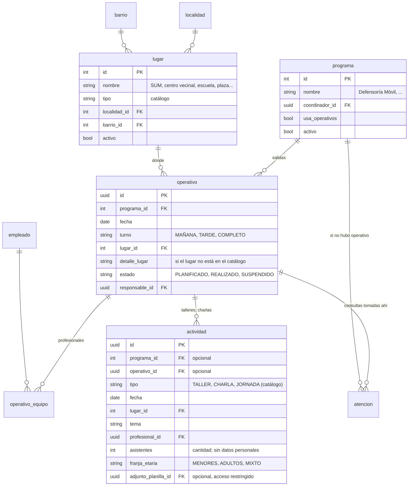

# Programas institucionales y operativos territoriales — análisis y propuesta v0.1 (2026-11-19)

> Ficha de relevamiento `P-PRG-01`. Fuente: el informe de gestión territorial de la Defensoría Móvil, marzo–octubre
> 2026, que pasó el usuario. No se copian nombres de personas: solo estructura y cifras agregadas.

## 1. Qué es hoy
- **Defensoría Móvil** es un programa interno: un equipo interdisciplinario (abogados, psicólogos, trabajadores
  sociales, educación para la salud, medio ambiente, administrativos) con una coordinación, que sale a barrios,
  asentamientos y localidades. Brinda **atención** (consultas) y **actividades** (talleres, charlas, jornadas).
- No es el único programa: hay otros ⏳ (P14).
- **Problema actual:** la consulta tomada en un operativo se registra a nombre del asesor que la atendió. El sistema
  no sabe que vino del programa, así que el informe del programa se arma **a mano** con planillas mensuales.

## 2. Lo que muestra el informe (y que el sistema tiene que poder generar solo)
- **Operativos:** unos 110 en 8 meses. Cada uno tiene fecha, lugar (barrio, institución anfitriona como un centro
  vecinal, un SUM, una capilla, una escuela o un centro de jubilados, o una localidad) y a veces **turno**
  (mañana/tarde). Hay días con **dos operativos** en lugares distintos. Algunos figuran "sin especificar barrio".
- **Lugares que se repiten** (mismo SUM, misma feria, mismo centro de jubilados): conviene un catálogo de lugares.
- **Cifras por mes:** personas atendidas y consultas (en total, 1.462 personas y 2.452 consultas), con % por mes.
- **Cifras por profesional y mes:** personas y consultas.
- **Talleres:** aparecen con asistentes y sin consultas (ej. un taller en una escuela de Perico con 81 asistentes).
  No son consultas y no deben sumarse como tales.
- **Temáticas** agrupadas en **ejes** (Discapacidad y PNC, Previsional y Seguridad Social, Servicios públicos y Tarifa
  Social, Familia y violencia, Civil/tierras/vivienda, Consumidor, Salud/educación/documentación). Son **más amplios
  que el Nomenclador**: un eje junta temas de varias áreas.
- **Errores típicos de la carga manual** que el sistema evita: el mismo profesional escrito de varias formas, meses
  en los que un profesional figura con más personas que consultas, operativos sin barrio.
- El informe menciona la **Ley N° 6380** (ley de la Defensoría): responde en parte a P5 / LEGAL-01.
- Menciona **"conectividad móvil en territorio"**: hay que definir si cargan en el lugar (celular/notebook) o después
  ⏳ (P13).

## 3. Propuesta de modelo

- **La consulta no cambia de dueño:** sigue siendo del asesor que atendió (cuenta en su producción). Lo nuevo es que
  su **atención** queda marcada con el **programa** (y el **operativo**, si lo hubo). El informe del programa se
  calcula con esa marca. Así, **una consulta suma una sola vez** en el total general y aparece tanto en el informe del
  asesor como en el del programa, que son cortes del mismo total, no sumas aparte.
- La marca va en la **atención** (no en cada consulta) porque todas las consultas de una misma visita vienen por el
  mismo canal. Las consultas la heredan, sin duplicar el dato.
- **Cómo se carga (decidido 2026-11-19):** en el formulario de la consulta hay un control **"Pertenece a un
  programa:"** con la lista de programas activos (por defecto, ninguno). Al elegir uno, se puede indicar el
  operativo (fecha y lugar) si lo hubo. Sirve igual si se carga **en el momento** o **días después**. Atajo
  opcional: "Operativo de hoy", para no elegirlo en cada carga durante una jornada.
- **Corrección:** se puede **cambiar de programa** o **quitar la marca** después de cargada (usuario con permiso,
  motivo obligatorio). El cambio queda en la auditoría y los informes se recalculan solos.
- **Planificación:** la coordinación carga el cronograma (operativos `PLANIFICADO`), arma el equipo y al terminar lo
  marca `REALIZADO`. Con eso salen solos el cronograma del informe y la cobertura territorial (mapa por barrio).
- **Tipo de registro (decidido 2026-11-19):** el formulario arranca siempre en **"Consulta normal"** (la más común).
  Se puede marcar:
  - **"Consulta grupal"**: habilita más filas para sumar personas.
  - **"Taller / charla"**: pide **datos mínimos**, porque los participantes a veces no dan sus datos o son menores
    (charlas en colegios): fecha, lugar o institución, tema, profesional a cargo, cantidad de asistentes,
    franja etaria (ej. "menores", "adultos", "mixto") y observaciones. Sin datos personales de cada asistente.
  - **"Adjunta documentación"** (en talleres): foto o PDF de la planilla de asistencia, **solo para control
    interno**, con acceso restringido (puede tener datos de menores).
- **¿Los talleres cuentan como consultas?** Lo deciden las Autoridades. Mientras tanto queda como **parámetro del
  Panel del Superadministrador** (`talleres.cuentan_como_consultas`, por defecto **no**). Si se activa, cada taller
  suma como **una** consulta, no una por asistente (P19). Los asistentes siempre se informan aparte.
- Si en un taller alguien hace una consulta individual, se carga como consulta normal con el mismo programa.
- **Ejes temáticos** ⏳: catálogo `eje_tematico` con una relación N:M a `tema` del Nomenclador. Sirve para todos los
  informes, no solo para los de los programas (confirmar con la coordinación cuáles son los ejes oficiales).
- **Otros programas sin salidas a territorio** (por ejemplo, uno que atiende por teléfono): `usa_operativos = false`, y
  la atención se marca solo con el programa.

## 4. Informe del programa (I-05 en `INFORMES.md`)
Reproduce y mejora el informe actual: cronograma de operativos por mes, personas y consultas por mes (con %), por
profesional, por localidad y barrio, por eje y tema, actividades con asistentes, y comparación contra el período
anterior. Se exporta a PDF/Excel, con nombres de profesionales solo para uso interno.

## 5. Preguntas
- **P13 (respondida):** se carga en el momento **o** días después, y tiene que poder trabajarse **sin internet**
  → §6.
- **P14:** ¿qué otros programas existen? (nombre, si salen a territorio, quién coordina).
- **P15 (respondida):** talleres con datos mínimos y cantidad de asistentes, más la planilla adjunta opcional.
- **P19:** si las Autoridades deciden que los talleres cuentan, ¿suman **una** consulta por taller (recomendada) o
  **una por asistente**?

## 6. Modo sin conexión — plan v0.1 (para una fase posterior al núcleo)
**Objetivo:** que el equipo pueda registrar consultas y talleres en territorio aunque no haya internet, y que todo
se suba solo y sin duplicar cuando vuelva la conexión.

| Tema | Propuesta |
|---|---|
| Tecnología | La misma app web instalada como **PWA** (aplicación web que se instala en la notebook o el celular y funciona sin conexión). No es una app aparte |
| Qué funciona sin conexión | Registrar atenciones, consultas (normales y grupales) y talleres con su programa; buscar personas en una **copia reducida** de los catálogos (nomenclador, localidades, barrios, programas, lugares) |
| Qué **no** funciona sin conexión | Ver antecedentes completos, actuaciones y trámites, pases y numeraciones oficiales (necesitan el servidor) |
| Guardado local | En el navegador (IndexedDB), **cifrado** con una clave derivada de la sesión; se borra solo al sincronizar y a los N días ⏳ |
| Sincronización | Cola de envíos: al volver la conexión, sube todo en orden. Cada registro lleva un identificador único creado en el equipo (UUID), así nunca se duplica aunque se reintente |
| Personas repetidas | Si al sincronizar el DNI ya existe en la base, se vincula a esa persona; si hay diferencias (domicilio, teléfono), se marca para revisión en vez de pisar datos |
| Números oficiales | Se asignan **en el servidor** al sincronizar (nunca en el equipo), para no romper la correlatividad |
| Seguridad | Solo equipos autorizados y usuarios con permiso "trabajo sin conexión"; sesión sin conexión limitada (ej. 12 h); todo queda en la auditoría al subir |
| Avisos | Indicador siempre visible: "Sin conexión — 7 registros pendientes de subir" |

Riesgo: suma bastante complejidad (sincronización, conflictos, pruebas). Por eso se construye **después** del núcleo
del sistema (Mesa de Entradas, Asesor, Actuaciones), pero el modelo ya queda preparado: UUID generados en el equipo y
marca de programa en la atención (D-006, propuesta).
