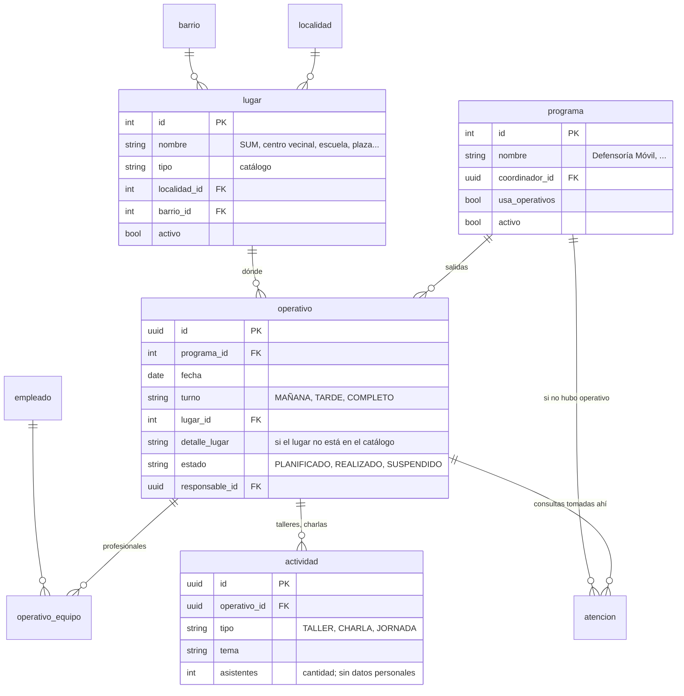

# Programas institucionales y operativos territoriales — análisis y propuesta v0.1 (2026-11-19)

> Ficha de relevamiento `P-PRG-01`. Fuente: el informe de gestión territorial de la Defensoría Móvil, marzo–octubre
> 2026, que pasó el usuario. No se copian nombres de personas: solo estructura y cifras agregadas.

## 1. Qué es hoy
- **Defensoría Móvil** es un programa interno: un equipo interdisciplinario (abogados, psicólogos, trabajadores
  sociales, educación para la salud, medio ambiente, administrativos) con una coordinación, que sale a barrios,
  asentamientos y localidades. Brinda **atención** (consultas) y **actividades** (talleres, charlas, jornadas).
- No es el único programa: hay otros ⏳ (P14).
- **Problema actual:** la consulta tomada en un operativo se registra a nombre del asesor que la atendió. El sistema
  no sabe que vino del programa, así que el informe del programa se arma **a mano** con planillas mensuales.

## 2. Lo que muestra el informe (y que el sistema tiene que poder generar solo)
- **Operativos:** unos 110 en 8 meses. Cada uno tiene fecha, lugar (barrio, institución anfitriona como un centro
  vecinal, un SUM, una capilla, una escuela o un centro de jubilados, o una localidad) y a veces **turno**
  (mañana/tarde). Hay días con **dos operativos** en lugares distintos. Algunos figuran "sin especificar barrio".
- **Lugares que se repiten** (mismo SUM, misma feria, mismo centro de jubilados): conviene un catálogo de lugares.
- **Cifras por mes:** personas atendidas y consultas (en total, 1.462 personas y 2.452 consultas), con % por mes.
- **Cifras por profesional y mes:** personas y consultas.
- **Talleres:** aparecen con asistentes y sin consultas (ej. un taller en una escuela de Perico con 81 asistentes).
  No son consultas y no deben sumarse como tales.
- **Temáticas** agrupadas en **ejes** (Discapacidad y PNC, Previsional y Seguridad Social, Servicios públicos y Tarifa
  Social, Familia y violencia, Civil/tierras/vivienda, Consumidor, Salud/educación/documentación). Son **más amplios
  que el Nomenclador**: un eje junta temas de varias áreas.
- **Errores típicos de la carga manual** que el sistema evita: el mismo profesional escrito de varias formas, meses
  en los que un profesional figura con más personas que consultas, operativos sin barrio.
- El informe menciona la **Ley N° 6380** (ley de la Defensoría): responde en parte a P5 / LEGAL-01.
- Menciona **"conectividad móvil en territorio"**: hay que definir si cargan en el lugar (celular/notebook) o después
  ⏳ (P13).

## 3. Propuesta de modelo

- **La consulta no cambia de dueño:** sigue siendo del asesor que atendió (cuenta en su producción). Lo nuevo es que
  su **atención** queda marcada con el **programa** (y el **operativo**, si lo hubo). El informe del programa se
  calcula con esa marca. Así, **una consulta suma una sola vez** en el total general y aparece tanto en el informe del
  asesor como en el del programa, que son cortes del mismo total, no sumas aparte.
- La marca va en la **atención** (no en cada consulta) porque todas las consultas de una misma visita vienen por el
  mismo canal. Las consultas la heredan, sin duplicar el dato.
- **Cómo se carga:** quien carga en un operativo elige "Operativo de hoy: [programa · lugar · turno]" una sola vez al
  empezar. Todas las atenciones que registre quedan marcadas sin tocar nada más. En la sede, por defecto, va
  "sin programa".
- **Planificación:** la coordinación carga el cronograma (operativos `PLANIFICADO`), arma el equipo y al terminar lo
  marca `REALIZADO`. Con eso salen solos el cronograma del informe y la cobertura territorial (mapa por barrio).
- **Talleres:** se registran como `actividad` con cantidad de asistentes. Si en el taller alguien hace una consulta,
  se carga como consulta normal dentro del mismo operativo.
- **Ejes temáticos** ⏳: catálogo `eje_tematico` con una relación N:M a `tema` del Nomenclador. Sirve para todos los
  informes, no solo para los de los programas (confirmar con la coordinación cuáles son los ejes oficiales).
- **Otros programas sin salidas a territorio** (por ejemplo, uno que atiende por teléfono): `usa_operativos = false`, y
  la atención se marca solo con el programa.

## 4. Informe del programa (I-05 en `INFORMES.md`)
Reproduce y mejora el informe actual: cronograma de operativos por mes, personas y consultas por mes (con %), por
profesional, por localidad y barrio, por eje y tema, actividades con asistentes, y comparación contra el período
anterior. Se exporta a PDF/Excel, con nombres de profesionales solo para uso interno.

## 5. Preguntas
- **P13:** ¿dónde cargan las consultas en un operativo? a) En el momento, con notebook o celular con datos
  (recomendada: el sistema web responsivo alcanza) · b) En papel y después en la sede · c) Ambas: hace falta un
  modo sin conexión (es mucho más complejo, se deja para una fase posterior).
- **P14:** ¿qué otros programas existen? (nombre, si salen a territorio, quién coordina).
- **P15:** en los talleres, ¿alcanza con la **cantidad** de asistentes o necesitan **lista nominal**? Recomendada:
  cantidad (mínimo dato necesario).
