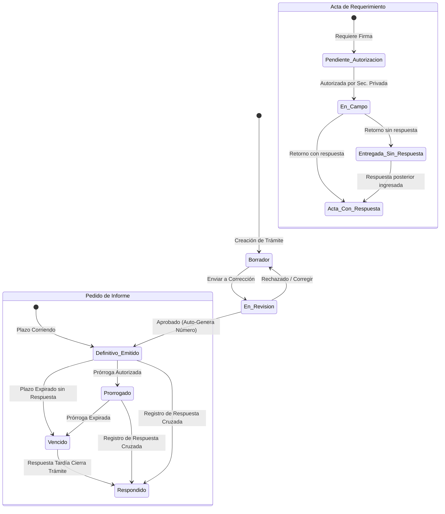

# Relevamiento de Procesos Actuales (Defensoría del Pueblo de Jujuy, Argentina)

Este documento registra el funcionamiento, estructuras de datos y lógica del sistema de escritorio actual de la **Defensoría del Pueblo de la Provincia de Jujuy, Argentina**. Nos sirve como base informativa para capturar reglas de negocio valiosas e identificar campos críticos.

---

## 1. Contexto Institucional, Geográfico e Infraestructura

*   **Institución:** Defensoría del Pueblo de la Provincia de Jujuy.
*   **País:** Argentina.
*   **Alcance:** Provincial (con fuerte implicación en localidades, departamentos y barrios de la provincia de Jujuy).
*   **Competencia General:** Brinda servicio de asesoramiento y/o intervención ante instituciones y organismos (provinciales, municipales, nacionales, etc.) y ante privados (con limitaciones). *(Detalles legales pendientes en [docs/FILOSOFIA_DISENO.md](FILOSOFIA_DISENO.md)).*

### Infraestructura Tecnológica Actual (Limitaciones Físicas)
El sistema actual opera a nivel de **Intranet** local y cuenta con severas restricciones de hardware que deben condicionar la arquitectura de la nueva solución:
*   **Motor e Interfaz Legacy:** Diseñado cerca de 2006 utilizando un motor tipo Visual FoxPro (o similar), pensado originalmente para monitores de tubo (CRT) y Windows XP. No es responsivo.
*   **Problema Crítico de Despliegue:** Al día de hoy no es compatible con sistemas modernos; los componentes de seguridad de Windows 11 catalogan falsamente sus ejecutables de instalación como virus, bloqueando por completo la instalación en nuevas computadoras.
*   **Servidores Físicos:** Windows Server local (para la aplicación) y Linux (para la base de datos). Tienen hardware obsoleto, discos rígidos mecánicos (HDD) lentos y baja memoria RAM.
*   *Requerimiento To-Be:* La arquitectura del nuevo sistema web en Azure resolverá de raíz los problemas de instalación y portabilidad (correrá en navegadores modernos sobre cualquier OS: Windows 10/11, Linux, macOS). Adicionalmente, el frontend React y backend Node.js estarán altamente optimizados para asegurar fluidez.

---

## 2. Glosario y Terminología de Negocio

Para modelar correctamente la base de datos y la interfaz, debemos respetar la terminología propia de la institución:

*   **Actuante:** Persona (física u organización) que concurre a realizar una consulta ante un profesional asesor de la Defensoría.
*   **Actuación (Expediente):** El expediente principal generado a partir del reclamo o servicio.
    *   **Actuación de Conflicto:** Expediente que requiere la intervención activa de la Defensoría y donde se inician trámites.
    *   **Actuación de Servicio:** Expediente rápido que se abre y se cierra en el mismo momento tras el asesoramiento del profesional, sin iniciar trámites posteriores.
*   **Trámite:** Las diferentes gestiones, escritos o hitos asociados a una Actuación de Conflicto.
    *   *Regla de Relación:* Un trámite puede pertenecer a una o más actuaciones, y una actuación puede tener múltiples trámites (Relación Muchos a Muchos - N:M).
*   **Consulta:** El registro de atención de una visita.
    *   **Consulta Múltiple:** Si un Actuante asiste por un tema y termina consultando por varios temas diferentes en la misma sesión. El Asesor puede registrar estas consultas adicionales de manera autónoma clonando los datos de la persona o grupo de personas atendido para asociar una nueva problemática. El sistema generará un indicador en el panel de Mesa de Entradas para señalar que se está llevando a cabo una "Atención Multi-temática" (varias consultas en la misma atención).
    *   **Consulta Grupal:** Si asiste más de una persona para una misma consulta con el asesor, todas las personas deben registrarse y quedar vinculadas a esa consulta.
    *   **Pre-consulta:** Visitas de ciudadanos por temas que no originan actuaciones ni asesoramiento formal (ej. solicitar audiencias o trámites varios). Se registran en Mesa de Entradas pero no pasan al Asesor.

---

## 3. Sectores de la Institución

El sistema debe contemplar flujos y permisos específicos para los siguientes sectores:

1.  **Mesa de Entradas (ME):** Sector inicial de recepción. Registra a las personas, detecta antecedentes, gestiona la cola de espera y deriva a los Asesores.
2.  **Asesores (Profesionales):** Abogados, Psicólogos, Trabajadores Sociales, etc. Atienden las consultas, cargan los dictámenes, crean Actuaciones y generan Trámites.
3.  **Administración:** Gestión administrativa general. Asocia e integra trámites con actuaciones, y carga la digitalización de la documentación (del expediente completo o trámite por trámite).
4.  **Informática:** Administradores del sistema, gestión de base de datos y permisos.
5.  **Delegaciones:** Oficinas de la Defensoría distribuidas en el interior de la provincia.
6.  **Sectores Pendientes de Definición de Roles:**
    *   *Secretaría Privada* (Defensor del Pueblo).
    *   *Secretaría General y Secretaría Legal y Técnica*.
    *   *Autoridades* (Defensor del Pueblo, Defensor Adjunto Primero y Segundo).

---

## 4. Flujo de Atención y Reglas en Mesa de Entradas (ME)

El nuevo sistema debe resolver de manera moderna estas necesidades críticas identificadas en el sistema actual:

### A. Detección de Antecedentes y Asesor Previo
Cuando un Actuante registrado vuelve, Mesa de Entradas debe ver de inmediato qué Asesor lo atendió previamente, el tema, la Actuación abierta, si debía traer documentación y el estado de sus trámites. Esto agiliza la asignación y permite mantener al mismo profesional a cargo.

### B. Monitoreo del Tiempo de Espera y Motivo de Consulta
*   **As-Is (Actual):** ME visualiza el nombre, tiempo transcurrido y Asesor asignado en la cola. Sin embargo, el motivo de consulta está oculto a menos que se abra el expediente individual de la consulta.
*   **To-Be (Mejora):** El motivo o área temática (ej: "Tarifas de luz", "Conflicto vecinal") debe ser visible directamente en la lista general de espera para que los operadores e investigadores tengan un contexto rápido de la fila sin clics adicionales.

### C. Consulta de Continuidad y Clonación de Datos (ME y Asesor)
*   **Clonación en Mesa de Entradas (ME):** Si un ciudadano viene por un tema de seguimiento, o si asiste por múltiples problemáticas en la misma fila, ME debe poder clonar/generar rápidamente una consulta similar para el mismo Actuante o grupo de personas, permitiendo cambiar únicamente la problemática o área temática elegida sin re-tipear la información básica.
*   **Creación Autónoma por el Asesor:** Si el profesional está atendiendo a un ciudadano y este plantea un tema completamente diferente, el Asesor debe poder generar y registrar nuevas consultas de manera autónoma en esa misma sesión (clonando los datos de la consulta base y modificando la problemática). Esto evita tener que enviar al ciudadano de regreso a Mesa de Entradas o pedirle al operador de ME que cargue una nueva derivación de forma manual.
*   **Indicador Visual en Mesa de Entradas:** El dashboard operativo de Mesa de Entradas debe reflejar en tiempo real que el ciudadano que se encuentra "En Atención" posee "Múltiples Consultas" o una "Atención Multi-temática", permitiendo visualizar la cantidad de consultas registradas en esa misma sesión de atención sin interferir con la fluidez del panel.

### D. Flujo del "Pase de Consulta" (Mesa de Entradas -> Asesor)
Este es el flujo crítico del sistema que genera la mayor fricción operativa actualmente:
1.  **Registro y Espera:** El ciudadano es registrado en Mesa de Entradas y su estado es "En Espera", asignado a un Asesor específico.
2.  **Llamada / Pedido de Pase:** Cuando el Asesor se libera, solicita a Mesa de Entradas que le envíe al ciudadano.
3.  **Envío del Pase (Punto de Bloqueo As-Is):**
    *   El operador de ME hace clic en enviar el "Pase".
    *   *Bloqueo:* La interfaz de usuario del operador de ME se congela/bloquea por completo y no permite realizar ninguna otra acción hasta que el Asesor acepta el pase desde su propia pantalla.
    *   *Consecuencia:* Si el Asesor está ocupado o tarda en aceptar, el operador de ME queda inhabilitado. Para solucionarlo, los operadores abren hasta 10 ventanas independientes del programa de escritorio, lo que satura la RAM del equipo cliente, genera tráfico redundante a la base de datos lenta en el servidor mecánico y causa tensiones en el personal.
4.  **Aceptación e Inicio de Atención:** Una vez que el Asesor hace clic en "Aceptar", la consulta pasa a estado "En Atención" y se libera la pantalla bloqueada en Mesa de Entradas.

#### Diseño Recomendado para el Nuevo Sistema (To-Be)
*   **Asincronismo Real (WebSockets / SSE):** El flujo de pases debe ser totalmente asíncrono. Cuando ME presiona "Derivar/Pasar", el estado de la consulta cambia a "Derivado" en la base de datos y se notifica en tiempo real al panel del Asesor mediante un evento (WebSockets o Server-Sent Events).
*   **Pantalla ME Libre:** El operador de Mesa de Entradas nunca debe experimentar un bloqueo de pantalla. Al derivar, la consulta desaparece de la lista local de pendientes (o cambia a estado derivado) y el operador queda inmediatamente habilitado para registrar al siguiente ciudadano.

---

## 5. Análisis de Pantallas Relevadas

### P-01: Inicio de Sesión (Login)
*   **Descripción:** Pantalla inicial de autenticación para todos los usuarios.
*   **Perfiles de Usuario Identificados:**
    *   `SUPERADM` (Superadministrador): Cuenta de control total. Habilita todas las opciones de administración y configuración del sistema.
    *   `ASESOR` (Vista de Asesores): Enfocada en la atención. Permite visualizar la lista de espera, cargar consultas, generar y consultar actuaciones/trámites, recibir notificaciones y alertas de vencimientos.
    *   `ADMINISTRATIVO` (Vista de Administración): Permite crear, modificar, actualizar, asociar y eliminar trámites y actuaciones. Habilita el módulo de digitalización para adjuntar archivos a expedientes y trámites.
    *   *Otros roles (Jerárquicos/Privados)*: Pendientes de definición en sus vistas y límites.

### P-02: Gestión de Empleados y Asignación de Sectores
*   **Descripción del Flujo As-Is (Fragmentado):** El alta de un nuevo empleado (ej. un Asesor) requiere navegar por múltiples submódulos desconectados.
    1.  El administrador ingresa a `Administración de Empleados`, carga los datos personales (CUIT, Nombre, Nacimiento, Dirección con selectores enlazados a tablas maestras de Barrios y Localidades) y lo asocia a una cuenta de usuario del sistema (Id Usuario de Sistema).
    2.  Guarda el registro y debe salir de esa pantalla.
    3.  Ingresa a un módulo totalmente distinto llamado `Administración de Empleados por Sector`.
    4.  Selecciona el Sector (ej. "ABOGADOS") usando un buscador (ícono de binoculares).
    5.  Busca el CUIT del empleado recién creado y guarda la relación.
*   **Problema Detectado:** Flujo ineficiente, propenso a errores humanos (olvidar asignar el sector, dejando al empleado inoperativo).
*   **Mejora To-Be:** En el nuevo sistema web, la vista de creación de Empleado/Usuario será unificada. Al crear o editar la persona, existirá un selector múltiple (ej. un *dropdown* moderno) para asignarle inmediatamente el Sector y el Rol (RBAC) en el mismo formulario y en un solo clic.

### P-03: Dashboard Operativo de Mesa de Entradas (Registro de Consultas)
*   **Descripción de la Vista (Patrón Maestro-Detalle):** Es la pantalla principal donde el personal de ME pasa el 90% de su jornada. Cuenta con un panel superior de filtros y **dos grillas sincronizadas**:
    *   **Grilla Superior (Maestro):** Muestra el listado de personas según el estado filtrado.
        *   *Si Estado = "En Espera":* Muestra la columna `Tiempo de Espera` (ej. "0 Hs 4 Min") y el botón crítico en el menú lateral es `Pasar Consulta al Asesor` (el cual detona el bloqueo documentado en CB-003).
        *   *Si Estado = "En Proceso":* La columna cambia a `Tiempo de Demora` (tiempo que lleva adentro del consultorio con el profesional).
    *   **Grilla Inferior (Detalle - Historial Activo):** Al hacer clic en una persona de la grilla superior, esta grilla inferior se autocompleta con sus `Actuaciones` históricas (Número, Año, Tipo, Tema Nomenclado, Asesor a cargo). Esto permite a ME ver los antecedentes instantáneamente.
*   **Problema de UX (Anti-patrón de Búsqueda):** Para buscar si una persona ya vino antes, el operador se ve forzado a cambiar el estado a "TODAS" y **borrar manualmente la fecha "De"** (que viene precargada por defecto) para que el sistema busque en el historial completo. Al no ser responsiva, la grilla oculta columnas críticas forzando el scroll horizontal.
*   **Mejora To-Be:** Separar conceptos y modernizar el layout.
    *   **Buscador Omnipresente:** El nuevo sistema tendrá una Barra de Búsqueda Global (tipo Spotlight) para buscar DNI/Nombres instantáneamente sin alterar los filtros de la vista de "Fila de Espera de Hoy".
    *   **Filas Expandibles o Panel Lateral:** En pantallas modernas, el patrón Maestro-Detalle dividiendo la pantalla a la mitad roba mucho espacio vertical. Se reemplazará por filas expandibles (accordion) o un panel lateral (Drawer/Sidebar) que se deslice mostrando el historial completo del ciudadano seleccionado.

---

## 6. Catálogo de Menús (Estructura Legacy vista por perfil ADMINISTRATIVO)

Analizando la barra de navegación capturada desde un usuario con perfil `ADMINISTRATIVO` normal, identificamos un grave problema de filtrado de permisos: el sistema legacy le expone al personal opciones de configuración crítica (como los menús de `Definiciones` o `Seguridad`) que deberían ser exclusivas de un `SUPERADM`. 
A continuación catalogamos todo lo que está expuesto en esa barra superior, lo cual en el nuevo sistema web quedará estrictamente oculto bajo un sólido control de roles (RBAC):

### A. Menú "Sistema"
*   **Cambiar Sesión...**: Permite cerrar la sesión del usuario actual e ingresar con otras credenciales sin cerrar el software.
*   **Salir**: Cierra el sistema.

### B. Menú "Definiciones" (Tablas Maestras y Catálogos)
Este menú contiene los datos estáticos de configuración que nutren a todo el sistema. Se dividen en los siguientes grupos lógicos:

1.  **División Geográfica (Maestros Territoriales):**
    *   `Países...`, `Provincias...`, `Departamentos...`, `Localidades...`
2.  **Gestión de Asesores:**
    *   `Asesores...` (Registro de los profesionales asignables).
3.  **Taxonomía de Problemáticas (Estructura de Temas):**
    *   `Áreas...`, `Grupos del Área...`, `Temas...`, `Nueva Estructura de Temas y Subtemas...`, `Motivos de Consultas sin Atender...`.
4.  **Flujos de Expedientes:**
    *   `Tipos de Actuaciones`, `Tipos de Trámites...`, `Motivos de Estados de Recepción de Trámites...`.
5.  **Identidades y Entidades Sociales:**
    *   `Personas...`, `Grupos Sociales...`, `Tipos de Documento...`.
6.  **Estructura Organizacional:**
    *   `Delegaciones...`, `Ámbitos de la Organización...`, `Empleados...`, `Empleados por Sector...`.
7.  **Relaciones Externas:**
    *   `Instituciones...` (Organismos públicos externos o empresas de servicios públicos).

### C. Menú "Módulo de Registro" (Operativa Diaria)
*   **PRE-Consultas...**: Registro rápido para temas que no requieren asesor (audiencias, etc.).
*   **Registro de Consultas...**: Carga del detalle de la entrevista de atención.
*   **Registro de Trámites...**: Carga y actualización de gestiones asociadas a expedientes.
*   **Registro de Actuaciones...**: Generación formal de los expedientes.
*   **Generar Remitos...**: Emisión de despachos físicos o digitales para enviar expedientes entre delegaciones o departamentos.

### D. Menú "Planillas y Listados" (Reportes e Inteligencia de Datos)
Módulo de reportes y búsqueda general del estado del sistema:
*   **Consultas...**: Buscador y reportes sobre registros de atención.
*   **Actuaciones**: Submenú con `Actuaciones...` (reportes de expedientes), `Circuito Interno de Actuaciones...` (trazabilidad del flujo interno) y `Trámites por Actuaciones...` (consulta de la relación N:M entre expedientes y gestiones).
*   **Tramites...**: Reportes específicos sobre diligencias individuales.
*   **Búsqueda General...**: Buscador transversal en toda la base de datos.
*   **Novedades por Asesor...**: Panel estadístico o alertas sobre la carga de los asesores.
*   **Consultar Resoluciones...**: Búsqueda de dictámenes finales o cierres.

### E. Menú "Seguridad" (Control de Accesos - RBAC)
*   **Perfiles**: Creación y definición de roles (ej. Administrador, Asesor, Mesa de Entradas).
*   **Usuarios**: Alta y baja de credenciales.
*   **Asignacion Usuarios Perfiles...**: Vinculación usuario ➔ rol.
*   **Autorizaciones...**: Permisos granulares o excepciones.

### F. Menús "Herramientas" y "Ayuda"
*   **Herramientas**: Utilidades locales (por relevar).
*   **Ayuda**:
    *   `Requerimientos - Sugerencias...`: Formulario para reportar problemas o mejoras.
    *   `Acerca de`: Información sobre la versión del software legada.

---

## 7. Registro de Auditoría de Vistas y Procesos Legacy (Tracking de Avance)

*Este registro actúa como el "tablero de control" de la auditoría del sistema anterior. Permite saber con exactitud científica qué partes del software de escritorio legado ya han sido relevadas, cuáles están bajo análisis y cuáles quedan pendientes para futuras sesiones.*

### A. Resumen del Estado de Auditoría (KPIs)
*   **Total de Vistas/Procesos Identificados:** 25
*   **🟢 Auditados Completamente:** 12 (48%)
*   **🟡 En Progreso / Auditoría Parcial:** 3 (12%)
*   **🔴 Pendientes de Auditoría:** 10 (40%)
*   *(2026-11-19: se sumó `P-PRG-01` Programas / Defensoría Móvil.)*
*   *(Corregido 2026-11-19: la matriz tiene 24 filas; antes figuraba 22.)*

---

### B. Matriz de Control de Auditoría (Módulos y Procesos)

| Área / Módulo | ID Vista | Nombre del Proceso / Vista Legacy | Estado | Última Revisión | Notas de Auditoría y Próximos Pasos |
| :--- | :--- | :--- | :--- | :--- | :--- |
| **Acceso y Seguridad** | `V-SEC-01` | Inicio de Sesión (Login) | 🟢 Auditada | 2026-05-26 | Mapeados perfiles principales (`SUPERADM`, `ASESOR`, `ADMINISTRATIVO`). Próximo paso: Definición de roles jerárquicos. |
| **Administración** | `V-ADM-01` | Gestión de Empleados y Sectores | 🟢 Auditada | 2026-05-26 | Identificado flujo fragmentado (CUIT ➔ Empleados por Sector). Se diseñó la mejora unificada en una sola vista. |
| **Mesa de Entradas** | `V-ME-01` | Dashboard Operativo de ME | 🟢 Auditada | 2026-05-26 | Analizada la grilla dual (Maestro-Detalle), filtros rígidos de fecha y el buscador legacy ineficiente. |
| **Mesa de Entradas** | `P-ME-02` | Flujo de Pase de Consulta (Derivación) | 🟢 Auditada | 2026-05-26 | Identificado el bloqueo síncrono crítico de pantalla. Resuelto en el To-Be mediante WebSockets asíncronos. |
| **Mesa de Entradas** | `V-ME-04` | Formulario de Registro de Consultas | 🟢 Auditada | 2026-05-26 | Relevada la captura legacy del formulario de FoxPro. Mapeados todos los campos, relaciones (Nro Actuación, Ide Persona, Barrio, Asesor, Origen/Institución) y diseñado el To-Be. |
| **Atención (Asesores)** | `P-AS-01` | Registro de Consulta y Multitemática | 🟢 Auditada | 2026-05-26 | Incorporada la creación autónoma por Asesor de consultas adicionales y el indicador visual en tiempo real para ME. |
| **Mesa de Entradas** | `V-ME-03` | Pre-Consultas | 🟡 En Progreso | 2026-05-26 | Registra gestiones rápidas (ej. audiencias) que no van al Asesor. Falta relevar la grilla de control de audiencias asignadas. |
| **Atención (Asesores)** | `V-AS-02` | Registro de Actuaciones (Expedientes) | 🟡 En Progreso | 2026-05-26 | Identificada separación entre "Servicio" y "Conflicto". Pendiente relevar el formulario exacto de carga en FoxPro. |
| **Atención (Asesores)** | `V-AS-03` | Registro de Trámites (Hitos N:M) | 🟢 Auditada | 2026-05-26 | Relevada la captura legacy. Mapeados filtros concurrentes, grilla dual de Trámites y Actuaciones Asociadas (relación N:M), menú de acciones (reiterar, re-asociar) y digitalización de adjuntos. |
| **Circuito Interno** | `P-INT-01` | Circuito Interno y Control de Pases Físicos | 🟢 Auditada | 2026-05-26 | Auditado el flujo legacy de pases físicos de expedientes. Diseñado el circuito digital asíncrono con control de autoría, historial de modificaciones y aceptación obligatoria del receptor. |
| **Trámites (Lógica)** | `P-TR-01` | Ciclo de Vida de Trámites (Borrador→Definitivo) | 🟢 Auditada | 2026-05-26 | Auditado el flujo de borradores, numeración automática del Libro Diario y autorización especial de Actas por Secretaría Privada. |
| **Trámites (Lógica)** | `P-TR-02` | Pedidos de Informe y Sistema de Reiteraciones | 🟢 Auditada | 2026-05-26 | Mapeadas reglas de límites (base + 2 reiteraciones), plazos (hábiles/corrido), alertas semáforo, generación en 1 clic y prórrogas autorizadas. |
| **Trámites (Lógica)** | `P-TR-03` | Cierre de Actuaciones (Acta / Constancia) | 🟢 Auditada | 2026-05-26 | Auditados los dos tipos de cierre (personal con firma física / no presencial sin firma). Definido el Plantillero Digital integrado para plantillas de documentos. |
| **Administración** | `V-ADM-02` | Módulo de Digitalización y Adjuntos | 🔴 Pendiente | - | Pendiente auditar cómo se suben/asocian archivos en FoxPro y el visor legacy. |
| **Administración** | `V-ADM-03` | Generación y Emisión de Remitos | 🔴 Pendiente | - | Pendiente auditar el circuito de pases físicos/remisiones de expedientes entre delegaciones. |
| **Tablas Maestras** | `V-DEF-01` | Gestión Geográfica (Barrios/Localidades) | 🔴 Pendiente | - | Pendiente auditar cómo se cargan nuevos barrios/localidades y su relación jerárquica. |
| **Tablas Maestras** | `V-DEF-02` | Taxonomía de Problemáticas (Nomenclador) | 🔴 Pendiente | - | Pendiente auditar la interfaz de configuración del nomenclador (Área ➔ Grupo ➔ Tema ➔ Subtema). |
| **Tablas Maestras** | `V-DEF-03` | Relación con Instituciones Externas | 🔴 Pendiente | - | Pendiente auditar el registro de organismos y empresas prestatarias. |
| **Tablas Maestras** | `V-PE-01` | Formulario de Administración de Personas | 🟢 Auditada | 2026-05-26 | Relevado el formulario legacy de administración de ciudadanos. Diseñado el To-Be con validación fuerte de DNI (Previene duplicación e inconsistencias). |
| **Reportes y Analítica**| `V-REP-01` | Planillas de Búsqueda y Consultas | 🔴 Pendiente | - | Pendiente auditar los filtros de reportes de consultas y planillas de control. |
| **Reportes y Analítica**| `V-REP-02` | Circuito Interno y Reportes de Actuación| 🔴 Pendiente | - | Pendiente auditar cómo se visualiza la trazabilidad histórica de un expediente. |
| **Reportes y Analítica**| `V-REP-03` | Novedades y Carga por Asesor | 🔴 Pendiente | - | Pendiente auditar el panel estadístico del rendimiento diario de los profesionales. |
| **Acceso y Seguridad** | `V-SEC-02` | Gestión de Perfiles y Autorizaciones | 🔴 Pendiente | - | Pendiente auditar la interfaz granular donde FoxPro define privilegios especiales. |
| **Herramientas** | `V-HER-01` | Utilidades Locales del Sistema | 🔴 Pendiente | - | Pendiente relevar qué opciones se agrupan en este menú. |
| **Programas** | `P-PRG-01` | Programas institucionales y operativos (Defensoría Móvil) | 🟡 En Progreso | 2026-11-19 | Analizado el informe de gestión territorial mar–oct 2026. Propuesta de programa/operativo/lugar/actividad en `docs/PROGRAMAS.md`. Faltan P13–P15. |

---

### C. Fichas de Auditoría Detallada (Historial de Sesiones)

#### Ficha `V-ME-03`: Pre-Consultas (Mesa de Entradas)
*   **Estado de Auditoría:** 🟡 En Progreso.
*   **Aspectos Relevados:**
    *   Registra ciudadanos que no requieren un Asesor técnico (ej. pedidos de audiencias con el Defensor o consultas institucionales rápidas).
    *   Finalizan en Mesa de Entradas.
*   **Aspectos Pendientes (Próxima Auditoría):**
    *   ¿Cómo se asocian las audiencias al calendario de los defensores?
    *   ¿Requiere vinculación con un "Nomenclador de Pre-consultas" o se registra en texto libre?

#### Ficha `V-AS-02`: Registro de Actuaciones (Expedientes)
*   **Estado de Auditoría:** 🟡 En Progreso.
*   **Aspectos Relevados:**
    *   Diferencia entre Actuación de Servicio (cierre rápido) y Actuación de Conflicto (inicia trámites).
*   **Aspectos Pendientes (Próxima Auditoría):**
    *   Auditar la interfaz del formulario en FoxPro: ¿Qué campos son obligatorios al crear el expediente? (Nro de Actuación, Año, Nomenclador de Problemáticas, Responsable, etc.).
    *   ~~¿Numeración por delegación o centralizada?~~ **Respondido 2026-11-19 (P1):** hoy es un correlativo único de corrido desde el inicio del sistema; el To-Be reinicia cada año, formato `DPJUJ-<número>-<año>` (configurable); el número histórico se conserva al migrar.

#### Ficha `P-PRG-01`: Programas institucionales y operativos territoriales (Defensoría Móvil)
*   **Estado de Auditoría:** 🟡 En Progreso (2026-11-19). Fuente: informe de gestión territorial mar–oct 2026.
*   **Aspectos Relevados:** operativos con fecha, lugar y turno (a veces dos por día); lugares que se repiten; cifras de personas y consultas por mes y por profesional; talleres con asistentes que no son consultas; temáticas agrupadas en ejes más amplios que el Nomenclador; hoy la consulta queda solo a nombre del asesor y el informe del programa se arma a mano. La ley de la Defensoría es la **Ley N° 6380**.
*   **Diseño To-Be:** marca de programa/operativo en la Atención (la consulta sigue siendo del asesor y suma una sola vez); catálogo de lugares; actividades con cantidad de asistentes; informe del programa automático. Detalle en `docs/PROGRAMAS.md` e `docs/INFORMES.md`.
*   **Pendiente:** P13 (carga en territorio), P14 (otros programas), P15 (asistentes).

#### Ficha `V-ME-04`: Formulario de Agregar Registro de Consultas (Mesa de Entradas)
*   **Estado de Auditoría:** 🟢 Auditada.
*   **Aspectos Relevados (Captura Legacy):**
    *   *Metadatos:* Año, Secuencia secuencial, Fecha, Hora y Tipo.
    *   *Nro Actuación:* Vinculación manual (0/0 si es nueva).
    *   *Ide Persona:* Tipo Documento (ej. DNI), Documento (ej. DNI `0` para "Sin Información"), Apellido, Nombre y Edad (ej. `CORRILLO, SUSANA RUFINA`, `79`).
    *   *Domicilio:* Calle, Nro, Barrio (enlazado por ID `30`), Localidad (enlazado por ID `1`), Código Postal (`4600`).
    *   *Otros Campos:* Representante, Delegación (`CASA CENTRAL`), Asesor (enlazado por ID/Binoculares), Referencia (texto libre), Origen (`Personal`) e Institución (enlazado por ID).
    *   *Acción Especial:* Check de "Consulta sin Atender" para deserciones.
*   **Diseño de Mejora To-Be:**
    *   Reemplazar la búsqueda por ID rígido de barrios/localidades por un combobox inteligente (dropdown moderno con búsqueda y autocompletado reactivo de la jerarquía territorial).
    *   Diseñar un formulario unificado y responsivo en React dividido en pasos lógicos, evitando amontonar más de 20 campos en una grilla plana.
    *   Implementar validación fuerte de identidad en el campo DNI para evitar la duplicación de datos inconsistentes (ej: DNI `0`).

#### Ficha `V-PE-01`: Formulario de Administración de Personas / Ciudadanos
*   **Estado de Auditoría:** 🟢 Auditada.
*   **Aspectos Relevados:**
    *   Auditoría de los flujos de carga de datos personales, detectando falta de validaciones cruzadas.
*   **Diseño de Mejora To-Be:**
    *   Implementar una validación estricta de DNI mediante Zod (tipos de documentos y máscaras de entrada).
    *   Diseñar un algoritmo de control de duplicados en tiempo real: al ingresar el documento, se busca fonética y numéricamente si ya existe en la base de datos de la Defensoría, mostrando antecedentes de forma inmediata en una alerta contextual.
    *   Manejo transparente del caso especial "Sin Información" utilizando una bandera boleana estructurada en la BD, en vez de rellenar con DNI `0`.

#### Ficha `V-AS-03`: Administración de Trámites (Atención - Asesores / Admin)
*   **Estado de Auditoría:** 🟢 Auditada.
*   **Aspectos Relevados (Captura Legacy):**
    *   *Filtros Concurrentes de Búsqueda:* Permite filtrar trámites por Tipo de Trámite, Clasificación (`Clasif`), Número, Año (`2026`), Concepto (texto libre), Rango de Fechas (`Desde` / `Hasta`), Estado de Curso, Ámbito, Organismo y Persona Emisora/Receptora.
    *   *Grilla Superior de Trámites:* Muestra las columnas `Año`, `Tipo Trámite`, `Nro`, `Clasif`, `Concepto`.
    *   *Grilla Inferior (Actuaciones Asociadas - Relación N:M):* Al seleccionar un trámite, la grilla inferior se autocompleta con las actuaciones vinculadas: `Nro`, `Año`, `Tip Id`, `Id Actu`, `Tema`, `Asesor`. Esto corrobora el requerimiento **N:M** (un trámite puede impactar en múltiples expedientes independientes de forma cruzada).
    *   *Panel de Acciones Lateral:*
        *   `Reiterar Trámite`
        *   `Cambiar Tipo-Clasificación`
        *   `Asoc a Rango de Actuaciones`
        *   `Asoc a Actuaciones Aleatorias`
        *   `Digitalizar Documentación` (Acceso al módulo de carga de adjuntos).
*   **Diseño de Mejora To-Be:**
    *   **Dashboard Unificado Relacional:** Layout moderno de dos paneles en React. Al hacer clic en un trámite se desliza un panel lateral con las actuaciones asociadas, con badges de colores por estado.
    *   **Filtros Avanzados Colapsables:** Los 10 inputs de filtro agrupados en un panel colapsable con chips activos para los filtros aplicados.
    *   **Buscador Rápido Reactivo:** Búsqueda en tiempo real por Concepto o Número con TanStack Query para cachear búsquedas repetidas.
    *   **Digitalización Directa:** Botón de subida con Drag-and-Drop integrado en la fila del trámite, con visor emergente (Modal) para pre-visualizar PDFs en Azure Blob Storage.

---

### C. Fichas de Auditoría: Procesos de Lógica de Negocio de Trámites

#### Ficha `P-TR-01`: Ciclo de Vida de Trámites (Borrador → Definitivo) y Libro Diario Digital
*   **Estado de Auditoría:** 🟢 Auditada.
*   **Aspectos Relevados:**
    *   **Plantillero de Documentos:** Existe una carpeta de plantillas institucionales para cada tipo de trámite (Pedidos de Informe, Notas, Actas, etc.) que establece el contenido base obligatorio. El nuevo sistema integra este Plantillero de forma digital y nativa.
    *   **Flujo Borrador → Definitivo:** Un documento se crea como borrador, se deriva para revisión (al Asesor o Secretario), y una vez aprobado pasa a estado "Definitivo".
    *   **Numeración Correlativa (Libro Diario):** Cuando un trámite se convierte en Definitivo, el sistema legado requería la asignación manual de un número del Libro Diario físico. El sistema To-Be lo automatiza mediante el backend NestJS.
    *   **Excepción de Actas:** Los números de Acta no se generan automáticamente; requieren revisión y autorización específica de la Secretaría Privada antes de obtener su número definitivo de Libro Diario, dado su alto valor legal.
    *   **Control de Versiones ("Ver Trámites Corregidos"):** La opción legacy permite ver borradores previos que ya pasaron a definitivo. La política es No Borrar: el borrador histórico queda guardado y se puede activar un filtro/switch para visualizarlo con su historial de autoría.
    *   **Buscador Semántico de Carátulas:** Para evitar inconsistencias en la nomenclatura de expedientes vinculados a una misma problemática puntual (ej. "Corte de luz Ejesa Barrio Malvinas"), el To-Be incluirá un buscador predictivo semántico al cargar la carátula, sugiriendo carátulas existentes similares.

#### Ficha `P-TR-02`: Pedidos de Informe y Sistema de Reiteraciones
*   **Estado de Auditoría:** 🟢 Auditada.
*   **Aspectos Relevados:**
    *   **Herramienta Principal:** El Pedido de Informe es el instrumento de investigación más frecuente, dirigido a empresas prestatarias (Ejesa, Agua de los Andes) u organismos públicos.
    *   **Regla de Límites:** Por cada destino (organismo o empresa) dentro de una Actuación: 1 Pedido de Informe base + máximo 2 Reiteraciones (`1ª Reiteración`, `2ª Reiteración`).
    *   **Plazos:** Cada Pedido de Informe tiene un plazo de respuesta configurable, distinguiendo entre días hábiles y días de corrido. La lista de plazos es administrada por el `SUPERADM`.
    *   **Alertas de Vencimiento tipo Semáforo:** El dashboard muestra Verde (a tiempo), Amarillo (próximo a vencer) y Rojo (vencido).
    *   **Generación de Reiteraciones en 1 Clic:** Si vence sin respuesta, un botón "Generar Reiteración" clona el contenido del original y crea automáticamente el siguiente trámite (`1ª Reiteración` → `2ª Reiteración`).
    *   **Prórrogas:** El destinatario puede solicitar una prórroga antes del vencimiento. Esta debe ser autorizada digitalmente por el Asesor a cargo o Secretario, lo que recalcula el vencimiento y queda registrado en el historial.
    *   **Acta de Requerimiento:** Cuando vencen las 2 reiteraciones sin respuesta, se emite un Acta de Requerimiento y personal se desplaza físicamente al organismo. El trámite pasa a estado "En Campo". Al regresar se registra si fue recepcionada y si trajo respuesta inmediata ("Acta con Respuesta").

#### Ficha `P-TR-03`: Cierre de Actuaciones
*   **Estado de Auditoría:** 🟢 Auditada.
*   **Aspectos Relevados:**
    *   **Acta de Cierre de Actuación (Presencial):** El Actuante asiste personalmente. El profesional informa verbalmente el resultado. Se genera e imprime el documento de Acta de Cierre usando la plantilla institucional. El Actuante firma físicamente. El documento firmado se escanea y digitaliza en el sistema. Cierra la Actuación con firma.
    *   **Constancia de Cierre de Actuación (No presencial):** Se aplica en dos casos:
        1.  La situación se resolvió y se comunicó telefónicamente (el Actuante no regresa a firmar).
        2.  Tras reiterados intentos de comunicación (telefónica u otro medio) no se consiguió contactar al Actuante.
    *   En ambos casos el profesional asienta la Constancia detallando las circunstancias. No requiere firma física. Sirve como cierre legal interno.
    *   **Plantillero Digital:** Cada tipo de trámite de cierre (y todos los trámites en general) tendrá asociada una plantilla institucional en el sistema To-Be que actúe como guía de contenido obligatorio para la redacción.

---

## 8. Lógicas de Negocio Avanzadas del Módulo de Trámites y Pases (To-Be Enterprise)

### A. Circuito de Pases con Referencia Predefinida y Administrable (`P-INT-01` Extendido)
*   **Regla de Negocio:** Cada pase digital y físico de expediente (Actuación) debe obligatoriamente llevar un motivo o referencia.
*   **Diseño To-Be:**
    *   **Selector Rápido:** Al realizar un pase, el sistema ofrecerá un menú desplegable de motivos predefinidos.
    *   **Panel de Administración:** Los usuarios con rol `SUPERADM` o roles jerárquicos autorizados dispondrán de una vista de configuración para agregar, modificar o dar de baja motivos predefinidos.

### B. Taxonomía, Agrupación y Simplificación de los 31 Tipos de Trámite
El sistema legacy cuenta con 31 tipos de trámites planos que sobrecargan la selección. Para el nuevo sistema web, se estructurará una jerarquía organizada en **7 macro-categorías lógicas**, simplificando la UI pero preservando la tipificación interna para reportes:

| Macro-Categoría To-Be | Cursos Permitidos | Ámbitos Aplicables | Tipos Detallados Legacy Incluidos |
| :--- | :--- | :--- | :--- |
| **1. Borradores y Trabajos** | `Interno` | No aplica | Borrador de Acta, Borrador de Pedido de Informe, Borrador de Resolución, Borrador Nota al Actuante, Borrador Notas Varias. |
| **2. Notas y Oficios Emitidos** | `Salida` | Todos | Nota a Actuante, Nota Actuación a Organismo, Nota General saliente, Oficio ingresante, Carta Documento. |
| **3. Notas y Oficios Recibidos** | `Entrada` | Todos | Nota de Actuante, Nota Actuación de Organismo, Nota General ingresante. |
| **4. Pedidos de Informe** | `Salida` / `Entrada` | Todos | Pedido de Informe, 1ª Reiteración, 2ª Reiteración. |
| **5. Actas y Gestiones Físicas** | `Entrada` / `Salida` | Todos | Actas, Constancia de Gestión, Consulta Telefónica, Mediación (trámite). |
| **6. Informes Técnicos** | `Interno` | No aplica | Informe de Entrevista, Informe Psicológico, Informe Social, Diagnóstico de Situación, Investigación de Actuación. |
| **7. Resoluciones y Cierres** | `Entrada` / `Salida` | Todos | Resolución, Respuesta, Descargo por infracción, Trámite Judicial, Formulario SuSePu, Recorte Periodístico, Documentación. |

*   **Curso de Trámite:** `Entrada`, `Salida`, `Interno` (para informes técnicos o borradores).
*   **Ámbito del Trámite:** Selector dinámico: `Nacional`, `Provincial`, `Municipal`, `Internacional`, `Privado`, `Particular`, `Otro`. Si se selecciona "Otro", el sistema habilitará un cuadro de texto libre para que el usuario escriba la descripción específica.

---

### C. Ciclo de Vida: De Borrador a Definitivo y la Numeración del Libro Diario

1.  **Flujo del Borrador:**
    *   Un administrativo o asesor crea un documento de trabajo (ej: `Borrador de Pedido de Informe`). El sistema solicita datos de la **Carátula de Actuación** (Nro, Año, Actuante).
    *   *Buscador Semántico de Carátula:* Para evitar que expedientes sobre una misma problemática (ej. "Corte de luz Ejesa Barrio Malvinas") se registren con nombres inconsistentes, el sistema implementará un buscador predictivo semántico que sugiere carátulas existentes similares al cargar.
    *   El borrador se deriva al Asesor a cargo o al Secretario para revisión y, una vez aprobado, cambia a estado **Definitivo**.
2.  **Numeración Automática (Libro Diario Digital):**
    *   La institución maneja un "Libro Diario" físico donde se asientan todos los números oficiales correlativos de los documentos al ingresar o salir.
    *   Al pasar un trámite a "Definitivo", el backend NestJS **generará automáticamente el número correlativo**, registrándolo en el Libro Diario Digital.
    *   *Excepción de Actas:* Los números de Acta son de alta relevancia legal. El sistema bloqueará la numeración automática de Actas hasta que sean **autorizadas digitalmente por la Secretaría Privada**.
    *   *Pendiente:* Recibir una foto de una hoja del Libro Diario real para diseñar su vista digital.

---

### D. Reglas Especiales para Pedidos de Informe y sus Reiteraciones (1ª y 2ª)
*   **Regla de Límites:** Por cada destino (organismo o empresa) en una Actuación: 1 Pedido de Informe base + hasta **2 Reiteraciones** (`1ª Reiteración` y `2ª Reiteración`).
*   **Plazos y Alertas Semáforo:**
    *   Cada pedido lleva un plazo de respuesta (ej. 24hs, 72hs, 5 días hábiles). La lista de plazos es configurable por el `SUPERADM`, distinguiendo **días hábiles** vs **de corrido**.
    *   El dashboard mostrará alertas tipo semáforo: Verde (a tiempo), Amarillo (próximo a vencer), Rojo (vencido).
*   **Generación de Reiteraciones en 1 Clic:** Al vencer sin respuesta, el botón "Generar Reiteración" crea instantáneamente el siguiente trámite clonando el contenido y autocompletando el título (`1ª Reiteración` → `2ª Reiteración`).
*   **Prórrogas:** El destinatario puede solicitar prórroga antes del vencimiento. Debe ser **autorizada digitalmente** por el Asesor o Secretario, recalculando el vencimiento y guardando el hito en el historial.

---

### E. Flujo del Acta de Requerimiento de Información
Cuando vencen las reiteraciones sin respuesta, la Defensoría emite un **Acta de Requerimiento** y el personal se apersona físicamente al organismo:
1.  **Estado "En Campo":** Al salir el personal con el Acta impresa, el trámite se marca como `En Campo`.
2.  **Registro al Regresar:** El personal registra el resultado de la visita: ¿Fue recepcionada el acta? ¿Trae respuesta inmediata? Si trae respuesta, el trámite se clasifica como **"Acta con Respuesta"** y se abre el formulario de carga.

---

### F. Registro de Respuestas y Cierre Cruzado de Trámites Pendientes
Cuando ingresa una **Respuesta** (por mesa de entradas o traída de campo):
*   El sistema registra los metadatos de la respuesta (remitente, fecha, adjunto digitalizado).
*   **Cierre Cruzado:** El sistema despliega automáticamente todos los trámites de investigación abiertos en esa Actuación. El usuario selecciona mediante *checkboxes* a cuáles responde este documento. Al guardar, el sistema marca todos los seleccionados como **"Respondido" (Cerrado)**, limpiándolos de las alertas de vencimiento.

---

### G. Máquina de Estados de Trámite (Escalable y Enterprise)
Cada tipo de trámite se gobernará bajo una máquina de estados estricta en el backend NestJS:

---

### H. Trámites Especiales de Cierre de Actuación
1.  **Acta de Cierre de Actuación (Personal):** El ciudadano asiste de forma presencial. El profesional le brinda el informe verbal final. Se genera e imprime el Acta de Cierre con la plantilla institucional. El Actuante la **firma físicamente**. El documento firmado se escanea y digitaliza en el sistema, cerrando la Actuación.
2.  **Constancia de Cierre de Actuación (No presencial):** Se aplica cuando:
    *   La situación se resolvió y se comunicó telefónicamente (el Actuante no regresa a firmar).
    *   Tras reiterados intentos de comunicación no se consiguió contactar al Actuante.
    *   El profesional asienta la Constancia detallando las circunstancias. **No requiere firma física**, sirviendo como cierre legal interno.
*   **Plantillero Digital Integrado:** El sistema incorporará un Plantillero Digital para cada tipo de trámite (Actas, Constancias, Notas), con plantillas institucionales en formato enriquecido que actúan como guía obligatoria de contenido para evitar discrepancias de redacción.

---

### I. Control de Versiones e Historial de Borradores ("Ver Trámites Corregidos")
*   **Regla de Negocio:** La opción legacy "Ver trámites corregidos" tiene un propósito de auditoría y control de responsabilidades.
*   **Diseño To-Be:**
    *   **No Sobrescribir:** Cuando un borrador pasa a Definitivo, el borrador original no se elimina ni se sobrescribe en la base de datos.
    *   **Versionado de Documentos:** El sistema guarda el historial inalterable de versiones: `Versión 1 (Borrador por Admin X)` → `Versión 2 (Corrección por Asesor Y)` → `Versión 3 (Definitivo por Secretario Z)`.
    *   **Visualización en la UI:** Por defecto, la grilla del expediente solo muestra la versión vigente definitiva. Al activar el switch **"Ver trámites corregidos"**, la grilla revela los borradores históricos previos con sus diferencias de texto (diff) y la autoría de cada cambio.

---

### J. Políticas de Eliminación de Trámites (Soft Delete / Anulado)
*   **Política de Cero Eliminación Física:** La eliminación física de trámites (Hard Delete) está **estrictamente prohibida** en la base de datos de producción para garantizar transparencia ante auditorías legales.
*   **Implementación To-Be (Soft Delete):**
    *   **Estado "Anulado":** Los usuarios con permisos administrativos pueden realizar una **Anulación (Baja Lógica)** en lugar de eliminar.
    *   El sistema exige de forma mandatoria ingresar el **Motivo de Anulación**.
    *   El trámite queda marcado como `"Anulado"` con el usuario, fecha/hora y motivo. Desaparece de la grilla ordinaria pero queda guardado para auditoría legal.

---

### K. Canales de Envío y Despacho de Trámites (Físico vs E-mail)
*   **Regla de Negocio:** Los trámites emitidos poseen diferentes cursos físicos o digitales.
*   **Diseño To-Be:**
    *   El sistema registrará de forma explícita el **Canal de Envío / Despacho**:
        1.  *Físico:* Despacho en papel gestionado por Mesa de Entradas mediante remitos y libros de cargo físicos.
        2.  *E-mail (Digital):* Despachos electrónicos directos.
    *   **Flujo de Envío por E-mail (Secretarías Privadas):** Los documentos aprobados en definitivo que deban salir vía digital son despachados por las **Secretarías Privadas del Defensor**. El sistema generará el PDF final con membrete y firma digital, lo adjuntará automáticamente al correo institucional del organismo/empresa destino (ej. Ejesa), guardando la traza: `"Enviado por Email por Secretaria Privada [Nombre] - [Fecha/Hora]"`.

---

## 9. Bitácoras de Sesiones de Trabajo

*Historial de las sesiones 1 a 3. **Desde el 2026-11-19 la bitácora se lleva en [BITACORA.md](BITACORA.md)** y la cola de trabajo en [TAREAS.md](TAREAS.md).*

### Sesión 1 — (2026-05-26)
*   **Actividades Realizadas:**
    *   Auditoría del flujo bloqueante de Mesa de Entradas (`P-ME-02`) → solución asíncrona To-Be por WebSockets.
    *   Auditoría de consultas múltiples (`P-AS-01`) → creación autónoma por Asesor (`RF-AS-002`) + indicador en tiempo real para ME (`RF-ME-008`).
    *   Estructurado el tablero de control de auditoría por módulos (Sección 7).
    *   **`V-ME-04`:** Formulario de Registro de Consultas → metadatos, campos relacionales, To-Be con formulario multistep y validación de DNI.
    *   **`V-PE-01`:** Administración de Personas → To-Be con detección de duplicados en tiempo real y manejo estructurado de "Sin Información".
    *   **`V-AS-03`:** Administración de Trámites → grilla N:M con actuaciones, panel de acciones laterales, To-Be con dashboard relacional y Drag-and-Drop.
    *   **`P-INT-01`:** Circuito Interno de pases físicos → motivos predefinidos y libres, historial de auditoría de usuarios, aceptación obligatoria del receptor.
    *   **`P-TR-01`, `P-TR-02`, `P-TR-03`:** 31 tipos de trámites → taxonomía en 7 macro-categorías, ciclo Borrador→Definitivo, Libro Diario Digital, Pedidos de Informe con reiteraciones y semáforos, cierres de Actuación, Soft Delete.
*   **Último punto auditado:** Canales de envío (`8.K`): físico (remitos) y e-mail (Secretarías Privadas, PDF con membrete automático).
*   **Próximos pasos para la siguiente sesión:**
    1.  🔴 `V-AS-02` — Relevar formulario exacto de carga de Actuaciones en FoxPro (campos obligatorios, numeración por delegación vs. centralizada).
    2.  🔴 `V-ME-03` — Completar auditoría de Pre-Consultas (calendario de audiencias y nomenclador).
    3.  🔴 `V-ADM-02` — Módulo de digitalización y adjuntos de FoxPro.
    4.  🔴 `V-ADM-03` — Generación y emisión de Remitos entre delegaciones.
    5.  🔴 `V-DEF-01` / `V-DEF-02` / `V-DEF-03` — Tablas maestras (geografía, nomenclador de problemáticas e instituciones).
    6.  🔴 `V-REP-01` / `V-REP-02` / `V-REP-03` — Módulos de reportes y circuito interno de actuaciones.

### Sesión 2 — (2026-05-26 / 2026-05-27)

*   **Resumen de actividades:**
    *   Verificación completa de integridad del documento `RELEVAMIENTO.md`.
    *   Actualización de KPIs del tablero de auditoría (Sección 7.A): 9 auditadas → **12 auditadas (55%)**.
    *   Incorporación de 3 nuevas filas en la Matriz de Control (Sección 7.B): `P-TR-01`, `P-TR-02`, `P-TR-03`.
    *   Incorporación de fichas de auditoría detalladas `P-TR-01`, `P-TR-02`, `P-TR-03` en Sección 7.C.
    *   Corrección estructural completa del documento: eliminación de secciones duplicadas, restauración de subsecciones `8.C` a `8.K` (Ciclo de Vida, Pedidos de Informe, Acta de Requerimiento, Cierre Cruzado, Máquina de Estados, Cierres, Versionado, Soft Delete, Canales de Envío), reordenamiento Sección 8 → Sección 9 (Bitácoras).
*   **Estado del documento al cierre de sesión:** ✅ Íntegro, sin duplicados, correctamente estructurado y listo para retomar.

---

#### 🔴 Cola de Trabajo — Próxima Sesión (Prioridad Alta → Baja)

| # | ID Vista | Módulo | Nombre del Proceso / Vista | Qué se necesita para auditarla |
|:---:|:---:|:---|:---|:---|
| 1 | `V-AS-02` | Atención (Asesores) | **Registro de Actuaciones (Expedientes)** | Captura legacy del formulario de carga de FoxPro. Resolver: ¿qué campos son obligatorios? ¿numeración automática centralizada o por delegación? |
| 2 | `V-ME-03` | Mesa de Entradas | **Pre-Consultas** | Captura legacy de la grilla de pre-consultas. Resolver: ¿cómo se vinculan al calendario de audiencias? ¿nomenclador propio o texto libre? |
| 3 | `V-ADM-02` | Administración | **Módulo de Digitalización y Adjuntos** | Captura legacy del módulo de carga de archivos. Resolver: ¿cómo funciona el visor legacy? ¿se adjunta por trámite o por actuación? |
| 4 | `V-ADM-03` | Administración | **Generación y Emisión de Remitos** | Captura legacy del formulario de remitos. Resolver: ¿qué datos lleva el remito? ¿cómo circula entre delegaciones? |
| 5 | `V-DEF-01` | Tablas Maestras | **Gestión Geográfica (Barrios/Localidades)** | Captura o descripción de la interfaz de carga de barrios y localidades con su jerarquía. |
| 6 | `V-DEF-02` | Tablas Maestras | **Taxonomía de Problemáticas (Nomenclador)** | Captura o descripción de la interfaz de configuración del nomenclador (Área → Grupo → Tema → Subtema). |
| 7 | `V-DEF-03` | Tablas Maestras | **Relación con Instituciones Externas** | Captura o descripción del registro de organismos y empresas prestatarias (Ejesa, Agua de los Andes, etc.). |
| 8 | `V-REP-01` | Reportes | **Planillas de Búsqueda y Consultas** | Captura del módulo de reportes de consultas. Resolver: ¿qué filtros ofrece? ¿exporta a Excel/PDF? |
| 9 | `V-REP-02` | Reportes | **Circuito Interno y Reportes de Actuación** | Captura del reporte de trazabilidad histórica de un expediente. |
| 10 | `V-SEC-02` | Seguridad | **Gestión de Perfiles y Autorizaciones** | Captura de la interfaz de permisos granulares de FoxPro. |

#### 📌 Punto de Retoma Exacto para la Próxima Sesión

> Al iniciar la próxima sesión, comenzar por la **vista `V-AS-02` (Registro de Actuaciones)**, que es la más crítica funcionalmente: define cómo se genera el expediente principal del sistema y sus reglas de numeración. Si el usuario puede compartir capturas del formulario de FoxPro para crear/editar una Actuación, se podrá auditar completamente en esa sesión.

---

### Sesión 3 — (2026-11-19)

*   **Resumen de actividades:**
    *   Revisión diagnóstica completa del estado del proyecto: se auditaron todos los documentos existentes para generar un mapa claro de avance y deuda pendiente.
    *   **Inicialización del repositorio Git** y primer commit con toda la documentación existente.
    *   **Creación del repositorio remoto en GitHub:** `https://github.com/GonzaRada31/gedefensoria` y push inicial a rama `main`.
    *   Corrección crítica del `INDEX.md`: eliminadas todas las rutas absolutas `file:///c:/Users/redex/...` y reemplazadas por rutas relativas portables, garantizando que los links funcionen desde cualquier máquina tras clonar el repo.
    *   Actualización del `ROADMAP.md`: marcado como completado el ítem "Configuración del entorno de desarrollo y repositorio" con referencia al repo de GitHub.
    *   Creación del documento `HANDOFF.md` con el estado consolidado, diagnóstico de avance y cola de trabajo ordenada por prioridad para retomar desde otra máquina.
*   **Estado del documento al cierre de sesión:** ✅ Repositorio en GitHub al día. Documentación portátil y consistente.
*   **Próxima acción al retomar:** Continuar por `V-AS-02 — Registro de Actuaciones`. *(HANDOFF.md fue reemplazado el 2026-11-19 por [REGLAS.md](../REGLAS.md) y [TAREAS.md](TAREAS.md).)*
